# Five names for one signal

Consider a single physical quantity, the angular position of a throttle plate, and how the test bench represents it.

```mermaid
flowchart LR
    subgraph SW["The physical world"]
        W["throttle angle<br/>0–90°"]
    end
    subgraph SP["The connector"]
        P["pin 47<br/>0.5–4.5 V"]
    end
    subgraph SD["Inside the DUT"]
        R["ThrPosRaw<br/>12-bit ADC count, 0–4095"]
        F["ThrPosFilt<br/>0–100 %"]
    end
    subgraph SN["The network database"]
        N["EngThrPos<br/>8 bits, 0.4 %/bit, offset 0"]
    end
    subgraph SM["The plant model"]
        M["throttle.position<br/>0.0–1.0"]
    end
    subgraph ST["Your test"]
        T["throttle at 30%<br/>intent"]
    end

    W -- potentiometer --> P
    P -- ADC --> R
    R -- "filter + scaling" --> F
    F -- "database scaling" --> N
    N -- "bench mapping" --> M
    M -- "mapping layer" --> T

    classDef yours fill:#dbeafe,stroke:#3b82f6,color:#1e3a8a
    classDef dut fill:#fef3c7,stroke:#d97706,color:#78350f
    classDef model fill:#dcfce7,stroke:#16a34a,color:#14532d
    classDef world fill:#f3f4f6,stroke:#6b7280,color:#1f2937
    class T yours
    class R,F dut
    class M model
    class W,P,N world
```

Between the physical plate and your test's intent sit five names: a pin number, two internal symbols, a network signal, and a model variable.

Five names, five unit systems, and four scaling conversions, all for one plate on one shaft.
Each arrow in that chain is a conversion that somebody configured by hand, in a file, possibly years ago, possibly for a different variant.

## The three layers

### Raw

What the hardware literally holds.
Counts, bits, volts, bytes.
No physical meaning without a conversion.

### Physical

The engineering quantity.
Degrees, percent, newton-meters, kelvin.
Meaningful, but still bench- and implementation-specific.

### Intent

What the test means. "Throttle at 30%." "Idle." "Wide open." Durable across benches, variants, and years.

You write a good test in intent.
A mapping layer resolves it to physical, and the bench converts it to raw.
A fragile test uses raw values with a comment explaining the math.

## Failure modes

### Silent scaling errors

An incorrect factor does not throw.
It gives you 3.0 where you expected 30, or 30 where you expected 0.30.
The test fails, someone "fixes" the tolerance, and the wrongness is now permanent.

See [[avoid-unit-and-scaling-assumptions]].

### Drift between sources

Symbol files come from a build.
Network databases come from an architecture tool.
Bench configuration comes from a spreadsheet.
Model names come from the model.
Four sources of truth, four update cadences, and no one notices they diverged until a test reads a plausible incorrect number.

### Names in test code

Once a test contains a bench-specific label, it is welded to that bench.

See [[avoid-bench-specifics-in-test-code]] and [[why-abstraction-exists]].

## Why a mapping layer exists

Nearly all test frameworks give you some way to implement a translation table.
The table maps the intent-level name your test uses to the bench-level identifier, the units, and scaling for your test bench hardware.

A good mapping layer for the device under test is what makes your test suite portable.
But it also introduces opportunities for error during comparisons and transforms.

Each test program needs to know where this lives, who owns it, how to regenerate it, and how anyone knows if it is incorrect.

On most projects, the honest answer is "we wouldn't." Some teams add a consistency check between the mapping and its upstream sources.
Those teams catch a class of bug that otherwise costs weeks.

## Recommended practice

For each value you read or write, be able to answer three questions:

1. What are the units, and who decided?
2. What is the valid range, and what occurs outside it?
3. What is the update rate at the source?

If you cannot answer all three, you do not yet know what that number means.
