# Five names for one signal

Consider a single physical quantity, the angular position of a throttle plate, and how it is represented in the testbench.

```mermaid
flowchart LR
    subgraph SW["The physical world"]
        W["throttle angle<br/>0–90°"]
    end
    subgraph SP["The connector"]
        P["pin 47<br/>0.5–4.5 V"]
    end
    subgraph SD["Inside the DUT"]
        R["ThrPosRaw<br/>12-bit ADC count, 0–4095"]
        F["ThrPosFilt<br/>0–100 %"]
    end
    subgraph SN["The network database"]
        N["EngThrPos<br/>8 bits, 0.4 %/bit, offset 0"]
    end
    subgraph SM["The plant model"]
        M["throttle.position<br/>0.0–1.0"]
    end
    subgraph ST["Your test"]
        T["throttle at 30%<br/>intent"]
    end

    W -- potentiometer --> P
    P -- ADC --> R
    R -- "filter + scaling" --> F
    F -- "database scaling" --> N
    N -- "bench mapping" --> M
    M -- "mapping layer" --> T

    classDef yours fill:#dbeafe,stroke:#3b82f6,color:#1e3a8a
    classDef dut fill:#fef3c7,stroke:#d97706,color:#78350f
    classDef model fill:#dcfce7,stroke:#16a34a,color:#14532d
    classDef world fill:#f3f4f6,stroke:#6b7280,color:#1f2937
    class T yours
    class R,F dut
    class M model
    class W,P,N world
```

**Seven names. Five unit systems. Four scaling conversions.**

All for one plate on one shaft. Every arrow in that chain is a conversion that somebody configured by hand, in a file, possibly years ago, possibly for a different variant.

## The three layers worth naming

### Raw

What the hardware literally holds. Counts, bits, volts, bytes. No physical meaning without a conversion.

### Physical

The engineering quantity. Degrees, percent, newton-meters, kelvin. Meaningful, but still bench- and implementation-specific.

### Intent

What the test means. "Throttle at 30%." "Idle." "Wide open." Durable across benches, variants, and years.

A good test is written in intent, resolved to physical by a mapping layer, and converted to raw by the bench. A fragile test is written in raw values with a comment explaining the math.

## The three ways this goes wrong

### Silent scaling errors

A wrong factor doesn't throw. It gives you 3.0 where 30 was expected, or 30 where 0.30 was expected. The test fails, someone "fixes" the tolerance, and the wrongness is now permanent.

See [[pitfall-unit-assumption]].

### Drift between sources

Symbol files come from a build. Network databases come from an architecture tool. Bench configuration comes from a spreadsheet. Model names come from the model. Four sources of truth, four update cadences, and no one notices they've diverged until a test reads a plausible wrong number.

### Names in test code

Once a test contains a bench-specific label, it's welded to that bench.

See [[pitfall-hardcoded-bench-names]] and [[why-abstraction-exists]].

## Why a mapping layer exists

Nearly every test framework provides some way to implement a translation table between the intent-level name your test uses and the bench-level identifier, the units, and scaling for your testbench hardware.

Implementing a good mapping layer for the device under test is what makes your test suite portable, but also introduces opportunities for error during comparisons and transforms.

Every test program needs to know where this lives, who owns it, how it is regenerated, and how anyone would know if it were wrong.

On most projects, the honest answer is "we wouldn't." Teams that add a consistency check between the mapping and its upstream sources catch a class of bug that otherwise costs weeks.

## The habit to build

For every value you read or write, be able to answer three questions:

1. What are the units, and who decided?
2. What's the valid range, and what happens outside it?
3. What's the update rate at the source?
If you can't answer all three, you don't yet know what that number means.
