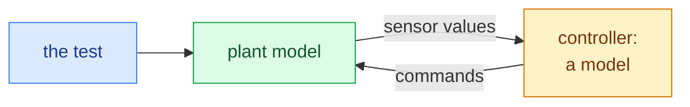
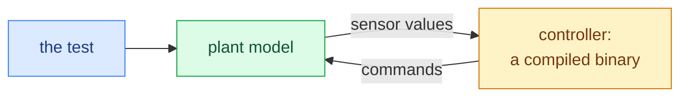
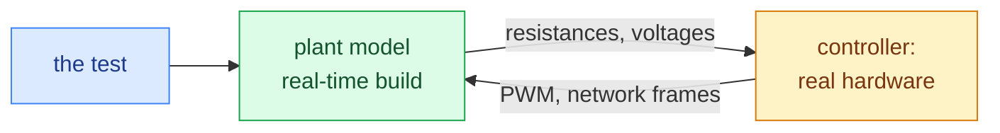

# One test on three benches

The acronyms MIL, SIL, and HIL are usually taught as vocabulary.
It is worth considering them as a single story about one test run three times.

Only the third of the three is a bench in the physical sense of [[what-a-hil-test-bench-is|a rack of hardware]].
The first two run on a desktop machine.
Read "bench" here as shorthand for whatever executes the test at that stage.

## The test

```
When the coolant temperature sensor reads above 110 °C for more than two seconds, the controller shall reduce commanded power to 50% and set a fault flag.
```

That sentence is the test.
Note what it does not mention:

- no bench
- no wiring
- no signal names
- no units conversion
- no tool

## Round 1: The controller is a model (MIL)

The control logic exists only as a block diagram or model.
There is no code and no hardware.

The plant model and the controller model run together on one desktop machine.
Execution is synchronous but not real-time, meaning the controller and plant step together.
A simulated second can take more or less than a wall-clock second.

- You set temperature by driving the plant model. See [[the-plant-model]].
- You observe the power command as a model variable.



### What you learn

Is the control *logic* right?
Is 110 °C the correct threshold?
Is two seconds the right debounce?

### What you cannot learn

You cannot learn anything about code, timing, hardware, or wiring.

## Round 2: The controller is compiled software (SIL)

The model has become C.
You compile the real production source for a host machine and run it against the same plant model, frequently still not in real time.
Same test intent and plant model, but the DUT is now a binary.



### What you learn

Did the code generation or hand-implementation preserve the logic?
This is where fixed-point rounding, integer overflow, initialization order, and similar issues surface.

### What you cannot learn

You cannot learn anything that requires the target processor or real I/O.

## Round 3: The controller is hardware (HIL)

You flash the production software onto the real controller, in its real housing, and wire it to a bench.
Now everything is in real time and executes as it does in-vehicle.

- Temperature is no longer a number you write. It is a resistance the bench presents across two pins, which the controller's ADC samples, scales, and filters. See [[physical-pins]].
- The power command is no longer a variable. It is a PWM duty cycle on an output pin, or a value in a network frame. See [[the-network]].



### What you learn

Does the whole thing work?
This covers sensor scaling, ADC noise, filter lag, task scheduling, driver bugs, and wiring.

### What you can now also do

Cut the sensor wire mid-test and confirm the controller notices.
See [[disturb]].

## What actually changes

|  | MIL | SIL | HIL |
| --- | --- | --- | --- |
| Test intent | same | same | same |
| Plant model | same | same | same (usually real-time build) |
| DUT | model | binary | hardware |
| Timing | free | free | real, hard |
| Signal names | model names | model names | model + symbol + pin + network names |
| Disturb | logical only | logical only | electrical too |

**The intent never moved.
The plumbing moved three times.**

That is the entire argument for [[why-abstraction-exists|why abstraction exists]].
It is why a well-built test suite has its intent in one place and its bench specifics in another.

## Caveats

- Test reuse across stages is the dream, but very hard to realize. Expect the structure to survive and the details to need work.
- Some tests only make sense at one stage. Electrical fault injection has no MIL equivalent. Exhaustive parameter sweeps are usually only affordable in SIL.
- A test that passed in MIL and fails in HIL has *not* wasted your time. That delta is exactly the information you paid for.

## Related terms

You will also encounter PIL (processor-in-the-loop, the real chip but not the real board), VIL (vehicle-in-the-loop), and various house-specific coinages.

The pattern is always the same.
X-in-the-loop means X is real and everything else is simulated.
