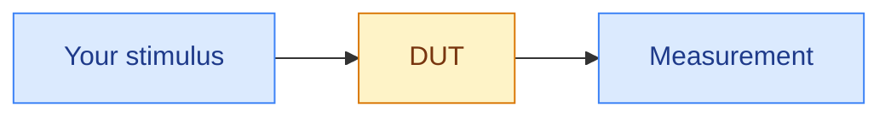
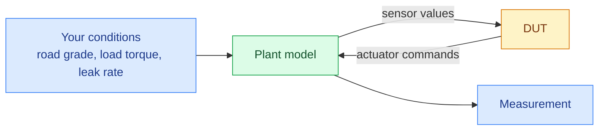

# Open loop vs closed loop

You run two fundamentally different test setups on the same rack, and confusing them produces tests that pass for the incorrect reason.

## Open loop

Nothing feeds back.
The DUT's outputs end at your measurement.



Open-loop testing is useful for:

- a check of a transfer function
- verification that the DUT decodes a signal correctly
- characterization of a response curve
- most component-level and bring-up work

The DUT's reaction has no impact on the stimulus.
That is exactly the point.
You get a clean, repeatable input for verifying any outputs that are time-invariant.

## Closed loop

The DUT controls something, even if that something is a simulation.



Closed-loop testing is useful for verifying control behavior, stability, fault reactions, or anything where the answer to "what does the sensor read?" is "depends what the controller just did."

Here you cannot simply command a sensor value, because the plant model is also trying to set it and the plant model will win.
You set *conditions* like road grade, load torque, or leak rate and let the physics produce the sensor value.

## Understand the difference

New engineers write closed-loop tests as though they were open-loop:

```
Set the speed to 3000 rpm, then check the controller reduces fuel.
```

In closed loop, "set the speed" is not yours to set.
Speed is an *output* of the model.

What you can set is the load, or the commanded setpoint, or an injected offset.
If you force the speed variable directly, you fight the model, and one of three things occurs:

1. the model overwrites you next tick
2. you introduce a state the controller was never designed for
3. the test passes for a reason that will not survive the next model update

For each value you intend to write, ask who owns the variable.
If the model owns it, you influence it rather than assign it.

## Override on purpose

There are legitimate reasons to break the loop deliberately.
A test can call for you to freeze a sensor, clamp a feedback path, or inject an offset on top of the model's value.

The rule is that it must be a decision you made and documented in the test, not something you discovered by accident.
