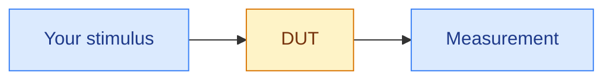
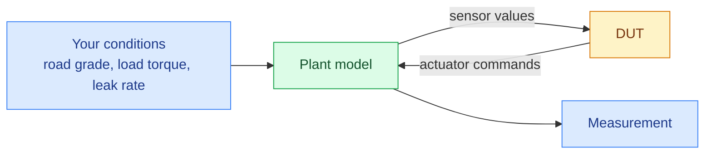

# Open loop vs closed loop

Two fundamentally different test setups get run on the same rack, and confusing them produces tests that pass for the wrong reason.

## Open loop

You drive the DUT's inputs directly. Nothing feeds back. The DUT's outputs go nowhere except into your measurement.



### Benefits

Open loop testing is useful for:

- checking a transfer function
- verifying a signal is decoded correctly
- characterising a response curve
- most component-level and bring-up work

The DUT's reaction has no impact on the stimulus. That is exactly the point. You get a clean, repeatable input for verifying any outputs that are time-invariant.

## Closed loop

The DUT's outputs drive a plant model, and the plant model produces the DUT's inputs. The DUT is controlling something, even if that something is simulated.



### Benefits

Closed loop testing is useful for validating control behaviour, stability, fault reactions, or anything where the answer to "what does the sensor read?" is "depends what the controller just did."

Here you cannot simply command a sensor value, because the plant model is also trying to set it and the plant model will win. You set *conditions* like road grade, load torque, or leak rate and let the physics produce the sensor value.

## Understanding the difference

New engineers write closed-loop tests as though they were open-loop:

```
Set the speed to 3000 rpm, then check the controller reduces fuel.
```

In closed loop, "set the speed" isn't yours to set. Speed is an *output* of the model. 

What you can set is the load, or the commanded setpoint, or an injected offset. If you force the speed variable directly, you are fighting the model, and one of three things happens: 

1. the model overwrites you next tick
2. you introduce a state the controller was never designed for
3. the test passes for a reason that will not survive the next model update

Ask, for every value you intend to write: who owns this variable? If the model owns it, you influence it rather than assign it.

## Overriding on purpose

There are legitimate reasons to break the loop deliberately. A test may call for you to freeze a sensor, clamp a feedback path, or inject an offset on top of the model's value. 

The rule is that it should be a decision you made and documented in the test, not something you discovered by accident.
