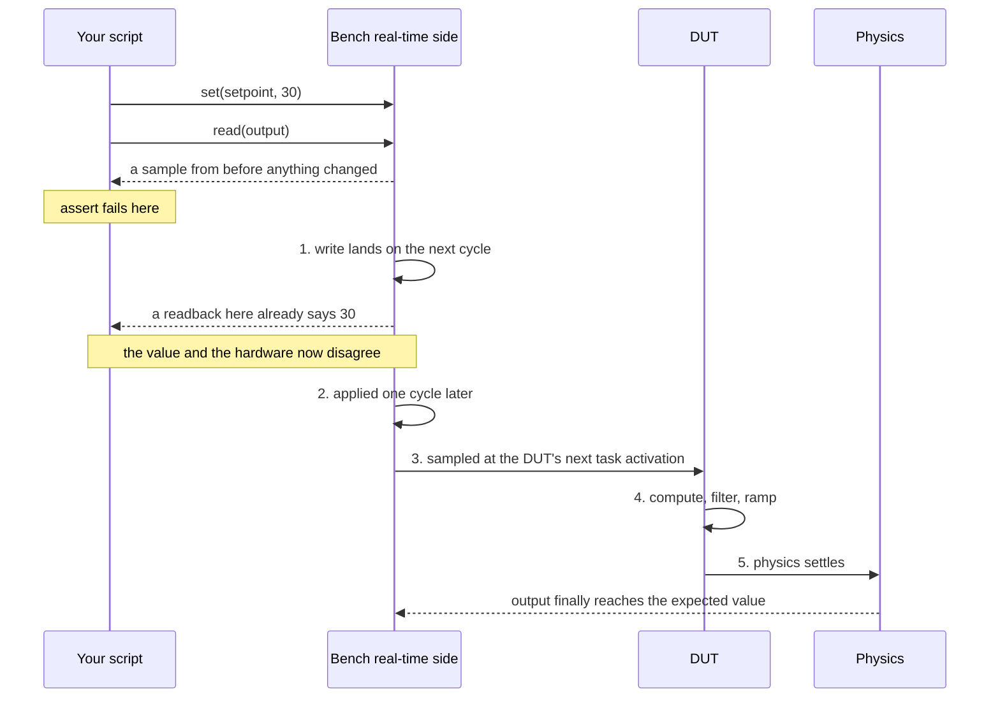

# Avoid immediately reading after writing

## The symptom

```
set(setpoint, 30)
assert read(output) == expected   # fails
```

You wrote the value. You read it back. It hasn't changed. Or worse — it changed, but not enough, and only sometimes.

## What's happening

Between your write and your read sit at least five delays, none of which you control:

1. The write travels to the real-time side and lands on the *next* cycle
2. The bench applies it — one cycle
3. The DUT samples its input on its own schedule — up to one task period
4. The DUT computes, filters, and ramps — the control law is not instant, and rate limiters exist precisely to make it not instant
5. The physics settles — a real quantity with mass or inertia takes real time



Then your read samples something that was true a few milliseconds ago. See [[time-is-the-hard-part]].

The trap also cuts the other way. Read the *setpoint* back in the gap between the write landing and being applied, and you get your new value while the hardware is still doing the old thing. That readback confirms nothing except that your write arrived — the value and the hardware disagree, and a test that treats it as proof the system responded is passing on false confidence.

## The fix that isn't a fix

```
set(setpoint, 30)
sleep(0.5)                        # ← the guess
assert read(output) == expected
```

This passes on your machine today. It's a guess tuned until the test went green, and it carries no information about what you were actually waiting for. Under load, on a busier bench, or after someone adds a filter, it becomes an intermittent failure. Intermittent failures are how test suites lose credibility.

## The actual fix

Wait for the **condition**, bounded by a timeout, and fail with a message that says what you wanted:

```
set(setpoint, 30)
wait_until(lambda: within(read(output), expected, tol),
           timeout=2.0,
           message="output never reached setpoint")
```

Now the test says what it means. It's fast when the system is fast, patient when it's slow, and when it fails it tells you something.

## Better still, when timing is the point

If the requirement is *"shall respond within 100 ms"*, a wait loop can't prove it — your polling isn't precise enough to measure 100 ms. Arm a [[capability-capture]] with a pre-trigger, apply the stimulus, and measure the response time from the captured timestamps. See [[triggers-and-windows]].

Rule of thumb: **waiting is for getting the system into a state. Capturing is for asserting on how it got there.**

## The one legitimate sleep

A short settle after a state change, where no observable condition marks completion and the delay is documented with a reason. Even then, prefer a condition if one exists. If you write a sleep, write a comment saying what physical process you're waiting for. If you can't name one, you're guessing.
