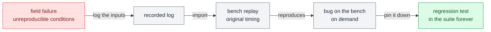

# Replay

**Do again exactly what happened before.**

Replay is [[stimulate|stimulate]] whose source is a recorded trace instead of a mathematical description. It closes the loop between the field and the lab.

## Why it matters

The most valuable test data your organization has is the recording of a failure in the field, under conditions you cannot reproduce. Replay is how that recording becomes a regression test.

A team that can do this has a fundamentally different debugging life from one that can't.

## Sources of replay traces

| Source | What it gives you |
| --- | --- |
| **Field recordings** | Real, messy, authoritative, and the point of the exercise |
| **Prior bench captures** | Replay a run that failed intermittently, or feed one subsystem's recorded output into another subsystem's test |
| **Synthesized traces** | A drive cycle, a mission profile, a standard duty cycle from a regulation |

## Where it works

| Boundary | What replaying means there |
| --- | --- |
| [[the-network]] | The classic case. Replay a recorded bus log so the DUT sees exactly the traffic it saw in the field. Watch for whether the bench replays *timing* faithfully or just message order |
| [[physical-pins]] | Play a recorded analog trace back out as a real waveform |
| [[the-plant-model]] | Drive model inputs from a recorded profile |
| [[the-service-layer]] | Replay a recorded request sequence; often awkward, because services are request/response and a blind replay can desynchronize |

## Replay fidelity questions

| Question | What to watch for |
| --- | --- |
| **Is timing preserved?** | Original inter-sample intervals, or a nominal fixed rate |
| **Is it interactive?** | A pure replay ignores the DUT. If the DUT was in a closed loop originally, blind replay may present it with a physically impossible situation |
| **What was not recorded?** | Everything absent from the log is being supplied by something else, probably a default. That gap is where "it reproduced but behaved differently" comes from |
| **Do the names and units still line up?** | See [[five-names-for-one-signal]] |

## Rule of thumb

Replay is at its best for **open-loop, observational** signals such as bus traffic, sensor inputs, and commands from another controller. It's at its weakest wherever the DUT's own behavior should have changed what it received. In closed loop, prefer replaying the *inputs to the plant model* over replaying the DUT's sensor values directly. That way the physics stays consistent.
