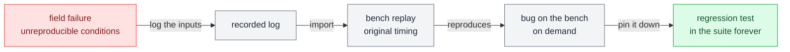

# Replay

**Do again exactly what occurred before.**

Replay is [[stimulate]] whose source is a recorded trace instead of a mathematical description. It closes the loop between the field and the lab.

## Why it matters

The most valuable test data your organization has is the recording of a failure in the field, under conditions you cannot reproduce. Replay is how that recording becomes a regression test.

A team that can do this has a fundamentally different debugging life from one that cannot.

## Sources of replay traces

| Source | What it gives you |
| --- | --- |
| **Field recordings** | Real, messy, authoritative, and the point of the exercise |
| **Prior bench captures** | Replay a run that failed intermittently, or feed one subsystem's recorded output into another subsystem's test. |
| **Synthesized traces** | A drive cycle, a mission profile, a standard duty cycle from a regulation |

## Where it works

| Boundary | What replaying means there |
| --- | --- |
| [[the-plant-model]] | Drive model inputs from a recorded profile. |
| [[device-internals]] | Not applicable in practice. Replaying calibration writes is possible, but this channel is too slow to reproduce the original timing. The exercise rarely earns its keep. |
| [[physical-pins]] | Play a recorded analog trace back out as a real waveform. |
| [[the-network]] | The classic case. Replay a recorded bus log. The DUT then sees exactly the traffic it saw in the field. Watch for whether the bench replays *timing* faithfully or just message order. |
| [[the-service-layer]] | Replay a recorded request sequence. Frequently awkward, because services are request/response and a blind replay can desynchronize. |

## Replay fidelity questions

| Question | What to watch for |
| --- | --- |
| **Does the replay preserve timing?** | Original inter-sample intervals, or a nominal fixed rate |
| **Is it interactive?** | A pure replay ignores the DUT. If the DUT was in a closed loop originally, blind replay can present it with a physically impossible situation. |
| **What did the log not record?** | Something else supplies everything absent from the log, probably a default. That gap is where "it reproduced but behaved differently" comes from. |
| **Do the names and units still line up?** | See [[five-names-for-one-signal]]. |

## Rule of thumb

Replay is at its best for **open-loop, observational** signals such as bus traffic, sensor inputs, and commands from another controller. It is at its weakest wherever the DUT's own behavior changes what it receives. In closed loop, prefer replaying the *inputs to the plant model* over replaying the DUT's sensor values directly. That way the physics stays consistent.
