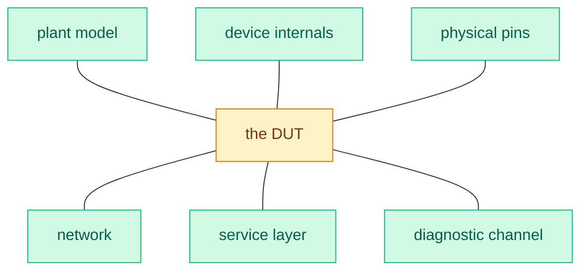

# The capability grid

Each test system does a small number of things to a small number of surfaces.
Six capabilities at six boundaries cover the entirety of what HIL does and where it occurs.

## The six verbs

| Verb | What it means |
| --- | --- |
| [[observe]] | What is this value right now? |
| [[stimulate]] | Make this value be something. |
| [[capture]] | What did this value do over that window? |
| [[replay]] | Do again exactly what occurred before. |
| [[disturb]] | What occurs when this fails? |
| [[interrogate]] | What does the device think failed? |

## The six boundaries

| Boundary | What it is |
| --- | --- |
| [[the-plant-model]] | The simulated world around the device |
| [[device-internals]] | The device's own memory and calibrations |
| [[physical-pins]] | Wires, voltages, currents, resistances |
| [[the-network]] | Frames and signals on a bus |
| [[the-service-layer]] | Requests, responses, and events between software services |
| [[the-diagnostic-channel]] | The device's self-report |

Six surfaces around one device:

## The grid

✅ = normal and well supported

⚠️ = possible but awkward, or bench-dependent

❌ = not available

|  | Observe | Stimulate | Capture | Replay | Disturb | Interrogate |
| --- | --- | --- | --- | --- | --- | --- |
| **Plant model** | ✅ | ✅ | ✅ | ✅ | ✅ | ❌ |
| **Device internals** | ✅ | ✅ | ✅ | ⚠️ | ⚠️ | ❌ |
| **Physical pins** | ✅ | ✅ | ✅ | ✅ | ✅ | ❌ |
| **Network** | ✅ | ✅ | ✅ | ✅ | ✅ | ⚠️ |
| **Service layer** | ✅ | ✅ | ✅ | ⚠️ | ✅ | ❌ |
| **Diagnostic channel** | ⚠️ | ⚠️ | ⚠️ | ❌ | ⚠️ | ✅ |

Do not take the marks as definitive.
They vary by bench, and arguing about a specific cell is a good way to learn.
The value is the shape: most cells are filled, which is why a bench feels overwhelming.

## How to use it

### Design a test

Write the goal in one plain sentence, then find each cell you need.
If a cell you need is ❌ or ⚠️ on your bench, you find your hard part before you start writing code. That is the cheapest possible time to find it.

### Evaluate a bench

Walk the grid and ask "can it do this, and at what rate?" That is the [[bench-evaluation-checklist|bench evaluation checklist]].

### Read a standard or a manual

Each concept or instruction serves one of the above cells.
When you know which one you are in, a massive standard becomes a lookup table for how to do [Capability] at [Boundary].

## What the grid does not show

It is a static picture of a system whose whole difficulty is dynamic.
Two things live off the grid and matter more than any single cell.

### Timing

Each cell has a rate, a latency, and a jitter, and those numbers decide whether your test is meaningful.
See [[time-is-the-hard-part]].

### Naming

The same physical quantity has a different name at each boundary, and translating between them is where the bugs are.
See [[five-names-for-one-signal]].
