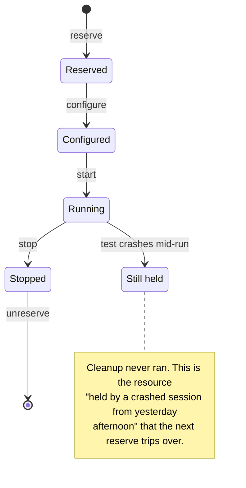

# The test bench resource model

Everything on a bench is a collection of shared, finite, stateful resources.

## The universal pattern

Every resource on every bench follows the same five steps:

| Step | What it does | What to watch for |
| --- | --- | --- |
| **Reserve** | Claim the resource. | It may be in use, in a bad state, or held by a crashed session from yesterday afternoon. |
| **Configure** | Say what you want: which signals, what rate, which trigger, which database. | Most things are only configurable *before* they start, which is why "I'll add that signal mid-run" usually isn't allowed. |
| **Start** | It begins doing its job. | Configuration is now frozen. |
| **Stop** | It stops. | Results may only be retrievable after this point, or may be lost by it. Know which. |
| **Unreserve** | Hand it back. | This is the one people skip, and skipping it is how benches become unusable. |

## Why the states exist

They're not bureaucracy. They exist because of real constraints:

- Real-time resources need their memory and schedule laid out before the loop starts. You can't renegotiate that mid-cycle without breaking determinism.
- Hardware is genuinely exclusive. Two tests cannot both own the same output.
- Some transitions take real time. Starting a model, opening a network channel, or establishing a diagnostic session are not instantaneous.

When an operation is rejected because you're "in the wrong state," the answer is almost never to retry. It's that you asked for something the system physically cannot do yet.

## Leave it as you found it

The rule that matters most, because violating it hurts other people:

- Restore every calibration value you changed. See [[boundary-device-internals]]
- Clear every fault you injected, and confirm it cleared
- Release every capture, stimulus, channel, and session
- Return overridden variables to model control
- Put the DUT back in a known state

Use whatever your language offers for guaranteed cleanup, such as try/finally, context managers, or fixtures with teardown.

Cleanup that only runs on the success path is not cleanup, and tests fail more often than they pass while you're writing them.

## The symptom of getting this wrong

The classic signature is the test passes alone and fails in the suite, or the first run passes and the second fails. Both mean someone left state behind.

When you see either, stop debugging the failing test and go look at what ran before it.

See [[pitfall-leaked-bench-resources]].
