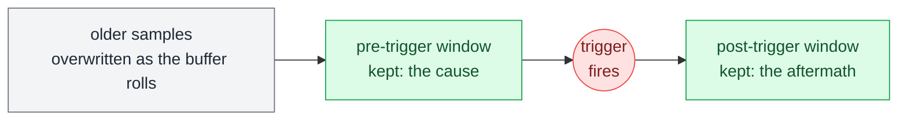

# Triggers and windows

A [[capability-capture]] needs a beginning and an end. How you choose them decides whether you get evidence or a pile of samples.

## Why not just record everything

Sometimes that is the right choice. For a short test, continuous capture of everything is the simplest thing that works, and storage is cheap.

But it stops scaling. High-rate signals across a long test produce data nobody will ever open, the interesting 50 ms is buried in twenty minutes of idle, and high-rate capture consumes real-time bandwidth and disk space you may not have.

More importantly, a well-chosen window is self-documenting. A capture that starts on the fault and ends on recovery is an artefact a reviewer can read. A twenty-minute dump is a research project.

## Ways to start

| Start | What it means | When it fits |
| --- | --- | --- |
| **Immediately** | You say go. | Your script is what causes the event. |
| **On a condition** | A signal crosses a threshold, a flag sets, a state changes. | The event's timing isn't yours to control. Condition-based triggers are evaluated on the real-time side, so they're precise. A trigger your script polls for is only as precise as your script, which is to say not very. See [[time-is-the-hard-part]]. |
| **On an external event** | A hardware trigger, a network frame, a diagnostic response. | Something outside the bench software marks the moment. |

## Ways to stop

| Stop | What it means | Watch out for |
| --- | --- | --- |
| **Fixed duration or sample count** | A set length, decided up front. | Predictable and bounded — the easy default. |
| **On a condition** | End when the system settles or the fault clears. | Always pair it with a maximum: a stop condition that never occurs is a capture that never ends. |
| **Manually** | Your script says stop. | Fine for exploratory work, imprecise for assertions. |

## Pre-trigger: the one that saves you

The bench continuously buffers samples. When the trigger fires, it keeps some window from *before* the trigger as well as after. This is how you capture the cause rather than only the aftermath. 

Time runs left to right:

When you are testing a fault reaction, the trigger is the reaction. Generally speaking though, what you actually want to see is the hundred milliseconds preceding it. Without a pre-trigger you get the consequence and have to guess at the lead-up.

Any time you catch yourself thinking "I wish I'd been recording just before that," you wanted a pre-trigger.

## Retriggering

Some captures can fire repeatedly, producing one segment per occurrence. Retriggering is ideal for intermittent behaviour: arm it, run for an hour, and get ten short segments around ten events instead of one enormous file.

## Practical defaults

- Arm the capture **before** the stimulus, always.
- Use a pre-trigger whenever the event isn't caused by your own script.
- Bound every condition-based window with a timeout.
- Capture a few more signals than you think you need. The cost of one extra channel is nothing; the cost of reproducing an intermittent failure is a day.
- Keep the raw capture even when the test passes, at least while a test is new. Trends in passing data catch problems before they become failures.
