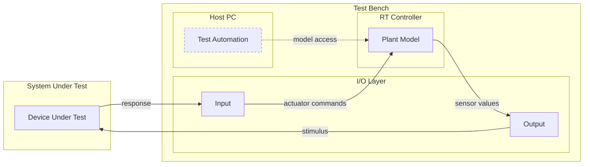

# What a HIL test bench is

A hardware-in-the-loop bench is a simulation system designed to convince a real controller that it is installed in a real machine.
In fact, the controller is bolted to a rack in a lab.
Everything else is detail.

## Components

| Part | What it is | Why it is there |
| --- | --- | --- |
| **Device under test (DUT)** | Real hardware, running real production software. | The only part you are actually testing. Everything else exists to fool it. |
| **Plant model** | A simulation of the world the DUT thinks it lives in. The motor, the vehicle, the battery, the hydraulics. | Consumes the DUT's outputs and produces the sensor values it expects to see. Runs on a computer that is fast and strictly timed. |
| **I/O layer** | The translation between simulated numbers and physical reality. Examples: a voltage on a pin, a current on a loop, a resistance across a sensor input, or a frame on a network. | This is where a number becomes an electron. |
| **Test automation** | Your code. It sets conditions, waits, observes, and decides pass or fail. | It is *not* part of the loop. See [[avoid-relying-on-scripting-for-time-sensitive-tasks]]. |

## The loop

The loop runs at a fixed rate, typically somewhere between 100 Hz and 10 kHz depending on the physics.
If the system runs, it continues to run whether your test script executes, sleeps, or crashed.

> [!tip] > Your test does not drive the loop.
It reaches into the loop, changes something, and watches what occurs.
Internalizing that one sentence is most of the conceptual jump.

## Advantages over the real machine

| Reason | What it buys you |
| --- | --- |
| **Cost** | Destroying a simulated gearbox is free. |
| **Safety** | You can test the runaway-motor case without a runaway motor. |
| **Coverage** | A fault that occurs once a year in the field fires each thirty seconds on the bench. See [[disturb]]. |
| **Availability** | The bench exists before the prototype does. |
| **Repeatability** | The same test produces the same conditions, which is the only way a regression suite means anything. |

## Limitations

This is worth saying early, because engineers tend to over-trust testing of any kind:

- It cannot find bugs in physics you modeled incorrect. See [[avoid-testing-the-model-instead-of-the-device]].
- It is usually poor at EMC, thermal, vibration, and mechanical wear analysis.
- Timing fidelity has limits. A bench running at 1 kHz cannot honestly test a 50 µs interrupt race.

A passing HIL suite means "the controller behaves correctly in the world we described." That is a large and useful claim.
It is not "the product works."
